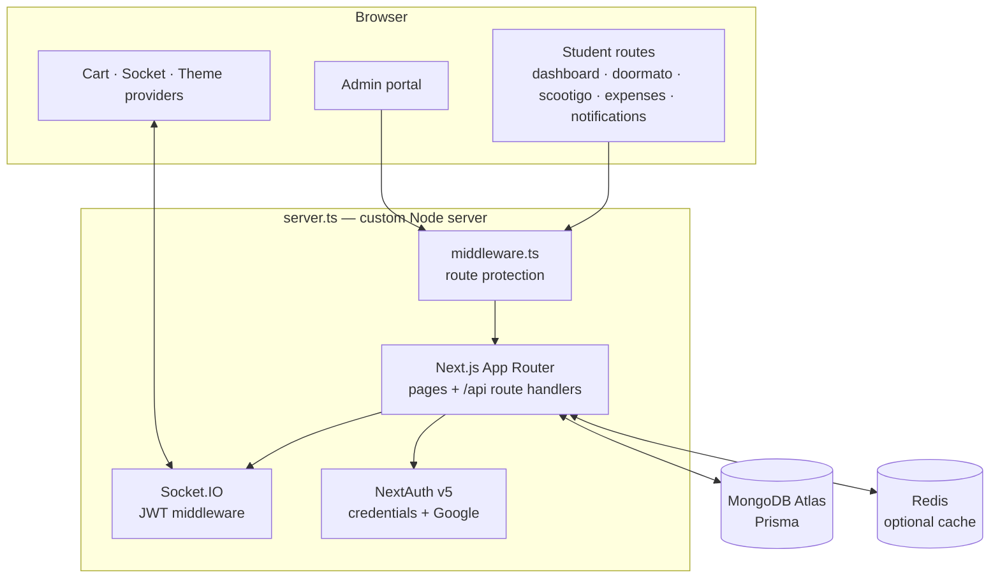
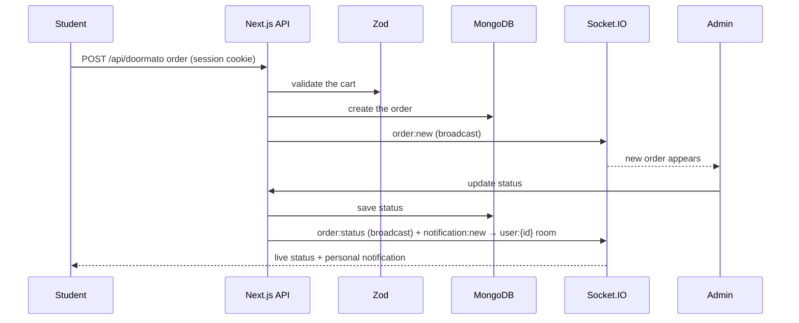

# PES Buddy

**A campus utilities platform — order from canteens, rent a scooter, track your spending, and get live updates, all behind one student login.**

[](pes-buddy-nextjs/package.json)
[](pes-buddy-nextjs/package.json)
[](pes-buddy-nextjs/lib/auth.ts)
[](pes-buddy-nextjs/prisma/schema.prisma)
[](pes-buddy-nextjs/server.ts)
[](pes-buddy-nextjs/tailwind.config.ts)

Four services in one app: **Doormato** for food ordering, **Scootigo** for
scooter rentals, an **Expense Tracker** for budgeting, and an **Admin Portal**
for monitoring and management. It started life as a C terminal menu and is now a
full-stack Next.js app with real-time notifications.

---

## Contents

| Section | |
|---|---|
| [What it does](#what-it-does) | The services, by area |
| [Architecture](#architecture) | Next.js, Socket.IO server, database, cache |
| [How an order travels](#how-an-order-travels) | Cart, order, live status |
| [Quick start](#quick-start) | Install, configure, seed, run |
| [Project status](#project-status) | Deployment and what is checked |
| [Design decisions](#design-decisions) | The tradeoffs, and why |
| [Repository layout](#repository-layout) | Where things live |
| [Reference](#reference) | Scripts, demo accounts, Atlas setup |
| [Team](#team) | Who built it |

---

## What it does

| Area | Capabilities |
|---|---|
| **Accounts** | Credential login with SRN + password, optional Google OAuth, JWT sessions, route protection in middleware |
| **Doormato** | Browse canteens and menus, add to cart, place and track orders |
| **Scootigo** | Browse available scooters, book rides, see booking history |
| **Expense Tracker** | Add, categorise and review spending |
| **Notifications** | Real-time order and booking updates over Socket.IO |
| **Admin Portal** | Manage orders and bookings, with dashboard analytics |
| **UI** | Responsive, dark-themed with glass effects; Framer Motion; `next-themes` |
| **Validation** | Zod schemas per domain, shared with react-hook-form |

---

## Architecture



Redis is optional: the app runs fully without it.

---

## How an order travels



---

## Quick start

```bash
# 1 — install
cd pes-buddy-nextjs
npm install

# 2 — configure
cp .env.example .env
#   NEXTAUTH_URL=http://localhost:3000
#   NEXTAUTH_SECRET=<a strong random secret>
#   DATABASE_URL="mongodb+srv://<user>:<password>@<cluster>.mongodb.net/<db>?retryWrites=true&w=majority"

# 3 — schema and sample data
npm run db:push
npm run db:seed

# 4 — run, with Socket.IO
npm run dev                   # http://localhost:3000
```

Demo accounts after seeding — student: SRN `PES1UG22CS001` / `Student@123`;
admin: `admin@pesbuddy.com` / `Admin@123`.

---

## Project status

All four services and the admin portal are implemented. The original C program
is preserved under [`legacy/C_Program/`](legacy/C_Program/) for history.

| Item | Status |
|---|---|
| Vercel deployment | ✅ REST API, auth and data features; set Root Directory to `pes-buddy-nextjs` |
| Real-time in production | ⚠️ Vercel serverless cannot hold WebSockets — run `server.ts` on Railway, Render or any Node host and set `NEXT_PUBLIC_SOCKET_URL` |
| CI | ⚠️ A workflow (typecheck, lint, build) is defined in `pes-buddy-nextjs/.github/`, but GitHub only runs workflows from the repository root, so it does not run yet |

---

## Design decisions

**One login, many services.** Every service sits behind the same NextAuth
session and the same middleware, so adding a service is adding routes, not
another auth system.

**A custom server for Socket.IO.** `server.ts` hosts Next.js and Socket.IO in one
process. Sockets authenticate with JWT middleware and join a personal
`user:{id}` room, so notifications go only to their owner while order status and
scooter availability are broadcast.

**Optional infrastructure.** Redis is a cache wrapper, not a dependency; the app
behaves the same without it.

**Validation lives with the domain.** Zod schemas under `lib/validations/` serve
both the API handlers and the forms, so the client and server agree on what is
valid.

**Say where real-time works.** Vercel serves the app; live updates need a
long-running Node host. The deployment notes say so instead of leaving it to be
discovered.

---

## Repository layout

```
.
├── pes-buddy-nextjs/
│   ├── app/
│   │   ├── (customer)/   dashboard, doormato, scootigo, expense-tracker, notifications, profile
│   │   ├── admin/        portal, login, register
│   │   ├── api/          auth, doormato, scootigo, expense, notifications, admin
│   │   └── auth/ · about/ · contact/
│   ├── components/       layout, providers (cart, socket, theme), ui
│   ├── features/         admin dashboard, doormato menu
│   ├── hooks/            useCart, useNotifications
│   ├── lib/              auth, Prisma client, optional Redis, Zod validations
│   ├── prisma/           schema.prisma, seed.ts
│   ├── middleware.ts     route protection
│   └── server.ts         custom HTTP server with Socket.IO
└── legacy/C_Program/     the original terminal menu system
```

---

## Reference

| Script | Description |
|---|---|
| `npm run dev` · `npm run start` | Dev or production server with Socket.IO (`server.ts`) |
| `npm run build` | Generate the Prisma client, then build |
| `npm run lint` · `npm run type-check` · `npm run format` | ESLint · `tsc --noEmit` · Prettier |
| `npm run db:push` · `db:seed` · `db:studio` · `db:generate` | Schema, sample data, Prisma Studio, client generation |

<details>
<summary><b>MongoDB Atlas and Vercel setup</b></summary>

1. Create a free cluster at [mongodb.com/atlas](https://mongodb.com/atlas) and a database user with read/write access.
2. Allow your IP (or `0.0.0.0/0` for Vercel).
3. **Connect → Drivers → Node.js** gives the connection string; set it as `DATABASE_URL` locally and in Vercel.
4. `npm run db:push`, then `npm run db:seed`.
5. In Vercel, set the Root Directory to `pes-buddy-nextjs` and add `DATABASE_URL`, `NEXTAUTH_SECRET`, `NEXTAUTH_URL` and `NEXT_PUBLIC_SOCKET_URL`.

</details>

---

## Team

| Member | Focus |
|---|---|
| **Guru R Bharadwaj** | Design and the full Next.js rebuild — services, admin portal, real-time layer |

---

## License

No license file is included; all rights reserved.
